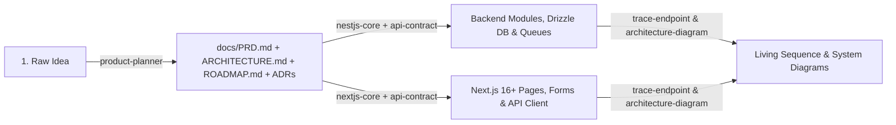

# Playbook — Agentic Development Skills

A curated collection of modular, token-efficient **AI Agent Skills** designed for building, architecting, and documenting production-grade applications with **TypeScript, Next.js (16+ App Router), NestJS, Drizzle ORM, Zod, Tailwind CSS, and shadcn/ui**.

---

## Why This Playbook?

1. **Progressive Disclosure (Token-Efficient):** Only each skill's `name` and 1-sentence `description` are loaded into context up front. Detailed runbooks (`SKILL.md`), framework code (`examples/`), and lookup tables (`references/`) are loaded **on demand** only when relevant.
2. **Automatic Skill Chaining:** Framework skills (`nestjs-core`, `nextjs-core`) automatically chain to `api-contract` whenever HTTP endpoints, DTOs, or API clients are touched—guaranteeing uniform validation and JSON envelopes across the stack.
3. **Topology-Aware (Solo vs. Monorepo):** Skills inspect your workspace first (`package.json`, `pnpm-workspace.yaml`, `turbo.json`, `apps/`, `packages/`) and adapt between standalone repositories and multi-package monorepos (`@repo/db`, `@repo/types`, `@repo/ui`).

---

## Repository Structure

```text
├── .gitignore
├── LICENSE
├── package.json
├── README.md
└── skills/
    ├── product-planner/                     # Interactive 7-stage product & architecture discovery
    │   ├── SKILL.md
    │   └── references/
    │       └── doc-templates.md             # Templates for PRD.md, ARCHITECTURE.md, ROADMAP.md & ADRs
    ├── api-contract/                        # Framework-agnostic REST API & envelope standard
    │   ├── SKILL.md
    │   ├── examples/
    │   │   ├── nestjs.md                    # NestJS Zod pipe, controller, service & exception filter
    │   │   └── nextjs.md                    # Next.js route.ts, Zod validation & error mapper
    │   └── references/
    │       └── error-codes.md               # Standard HTTP status -> UPPER_SNAKE_CASE error codes
    ├── nestjs-core/                         # Principal NestJS architecture, DI, Drizzle, queues & ops
    │   ├── SKILL.md
    │   └── examples/
    │       ├── module-and-di.md             # Solo/Monorepo DB wiring, ExternalAuthGuard & decorators
    │       └── queues-cache-and-ops.md      # BullMQ, EventEmitter, Cron, Redis cache, Throttler & health
    ├── nextjs-core/                         # Next.js 16+ App Router, RSC, TanStack Query, RHF & shadcn
    │   ├── SKILL.md
    │   └── examples/
    │       ├── data-fetching-and-api-client.md # Typed apiClient, async RSC params & nuqs URL state
    │       └── forms-actions-and-auth.md    # RHF + Zod + shadcn Form, Server Actions & 2-layer auth
    ├── trace-endpoint/                      # End-to-end API & background job flow tracer
    │   └── SKILL.md
    └── architecture-diagram/                # Code-driven system & cloud architecture diagrammer
        └── SKILL.md
```

---

## Skills Catalog

| Skill | Scope | When It Activates | Example Prompt |
|---|---|---|---|
| **[`product-planner`](./skills/product-planner/SKILL.md)** | Product & Architecture | Sharing a raw/vague app or feature idea; generating `PRD.md`, `ARCHITECTURE.md`, `ROADMAP.md`, and `adr/` | *"I want to build a multi-tenant B2B invoicing SaaS—help me plan it."* |
| **[`api-contract`](./skills/api-contract/SKILL.md)** | Any Backend Framework | Creating, updating, or reviewing REST endpoints, DTOs, validation schemas, or response envelopes | *"Create a `POST /v1/orders` endpoint with pagination on `GET`."* |
| **[`nestjs-core`](./skills/nestjs-core/SKILL.md)** | NestJS + Drizzle | Building NestJS modules, controllers, services, guards, decorators, Drizzle transactions, queues, or caching | *"Create an `OrdersModule` with stock reservation in a Drizzle transaction and a receipt queue job."* |
| **[`nextjs-core`](./skills/nextjs-core/SKILL.md)** | Next.js 16+ + UI | Building App Router pages, Server/Client Components, Server Actions, RHF + Zod forms, TanStack Query, or shadcn/ui | *"Build the `/dashboard/orders` page with URL search filters and a create order dialog."* |
| **[`trace-endpoint`](./skills/trace-endpoint/SKILL.md)** | Codebase Analysis | Explaining or diagramming how an endpoint or Server Action executes from client to DB and background workers | *"Trace `POST /v1/orders` end-to-end and draw the sequence diagram."* |
| **[`architecture-diagram`](./skills/architecture-diagram/SKILL.md)** | Infrastructure & Config | Drawing the system or cloud architecture from `package.json`, `.env.example`, Docker, CI, and IaC files | *"Draw the system and cloud architecture diagram for this repo."* |

---

## Installation & Setup

Install these skills into any project using the [`skills`](https://www.npmjs.com/package/skills) CLI:

### 1. Install All Skills into a Project
Downloads all skills into your project's `.agents/skills/` directory:

```bash
npx skills@latest add nikhilenigma/skills
```

### 2. Install Specific Skills Only (`--skill`)
Install only the skills needed for a particular repository:

```bash
# Install only backend skills
npx skills@latest add nikhilenigma/skills --skill api-contract --skill nestjs-core

# Install only the product planner
npx skills@latest add nikhilenigma/skills --skill product-planner
```

### 3. Global Installation (`-g`)
Install the skills globally so your agent can use them across every project on your machine:

```bash
npx skills@latest add nikhilenigma/skills -g
```

### 4. Target a Specific Agent (`-a`)
By default, skills install into `.agents/skills/`. You can also target specific agents such as Antigravity, Cursor, or Claude Code:

```bash
npx skills@latest add nikhilenigma/skills -a antigravity
npx skills@latest add nikhilenigma/skills -a claude-code
npx skills@latest add nikhilenigma/skills -a cursor
```

---

## How to Use the Skills

### 1. Automatic Activation (Default)
You do **not** need to type special commands. Simply describe your task naturally—the agent reads the skill descriptions and loads the matching skill(s) automatically:
```text
Create a PATCH /v1/products/:id endpoint that invalidates the Redis product cache.
```
*The agent automatically loads `nestjs-core` + `api-contract`, validates `:id` and body with Zod, updates via `async/await` in `ProductsService`, invalidates `product:<id>` in Redis, and returns `{ success: true, message, data, timestamp }`.*

### 2. Explicit Invocation
You can also name a skill or reference its path directly in your prompt:
```text
Use product-planner to help me architect a real-time fleet tracking platform.
```

---

## Detailed Skill Guide

### 1. `product-planner` — Interactive Product & Architecture Discovery
Turns a raw idea into a complete specification suite before a single line of application code is written.
- **How it works:** Uses `ask_question` **one question at a time** across 7 adaptive stages (Target Users, Scale/Concurrency, MVP Scope, App Topology, Tech Stack/DB, Auth/Billing/Integrations, Hosting/Ops).
- **5-Option Rule:** Every question gives **5 options**—Option 1 is `(Recommended)` with a rationale, Options 2–4 are concrete alternatives, and Option 5 is always *"We will take a custom approach (I will write my own answer)"*.
- **Outputs generated in `docs/`:**
  - `docs/PRD.md` — Personas, scale targets, user stories, acceptance criteria, and non-goals.
  - `docs/ARCHITECTURE.md` — Mermaid `flowchart LR` (system topology), `erDiagram` (database schema), and `sequenceDiagram` (critical flow).
  - `docs/ROADMAP.md` — Phased implementation checklist (Foundation → Core Domain → MVP Flows → Hardening).
  - `docs/adr/README.md` + `docs/adr/001-<slug>.md`, `002-<slug>.md`, ... — Architecture Decision Records.

---

### 2. `api-contract` — Unified REST API Standard (Framework-Agnostic)
Enforces a strict 5-stage execution pipeline across **any** backend framework (NestJS, Next.js Route Handlers, Express, FastAPI, Spring Boot):
1. **Sanitize & Validate All 3 Inputs (Zod Default):**
   - **Route Params:** `uuid`, `cuid`, `slug`, or `numericId` schemas.
   - **Query Params:** Coerced `page`/`limit` bounds (`1..100`), trimmed `search`/`sortBy`, `sortOrder` (`asc` | `desc`).
   - **Body Payload:** `z.object({...}).strict()`, `.trim()` strings, `.toLowerCase()` emails/slugs.
2. **Strict Input & Output DTO Boundaries:** `z.infer` input types passed from controller to service; explicit Output DTO mapping (`toDto`) so sensitive DB columns never leak.
3. **Thin Controller / Isolated Service:** Zero business logic or DB queries in controllers; all `async/await` DB work lives in the service (`Promise.all` only for parallel independent reads).
4. **Uniform JSON Envelopes (Always Includes `message`):**
   ```json
   // Success (200 / 201)
   {
     "success": true,
     "message": "Orders fetched successfully",
     "data": [],
     "meta": { "page": 1, "limit": 20, "total": 42, "totalPages": 3 },
     "timestamp": "2026-10-20T00:00:00.000Z"
   }

   // Error (4xx / 5xx)
   {
     "success": false,
     "message": "Invalid request input",
     "error": {
       "code": "VALIDATION_FAILED",
       "details": [{ "field": "email", "issue": "Invalid email format" }]
     },
     "timestamp": "2026-10-20T00:00:00.000Z",
     "path": "/v1/orders"
   }
   ```

---

### 3. `nestjs-core` — Production NestJS & Drizzle Architecture
Chains with `api-contract` and enforces:
- **Topology Detection:** Adapts between **Solo Repo** (`src/db/schema/index.ts` barrel + `src/db/migrations/`) and **Monorepo** (`apps/api` wrapping `@repo/db` and `@repo/types`).
- **Lifecycle Placement:** `CorrelationIdMiddleware` → `ExternalAuthGuard` (Clerk/Supabase/Auth0 token verification + webhook/idempotent Drizzle user upsert) & `RolesGuard` → `ZodValidationPipe` → Controller → Service (`db.transaction()`) → `ApiExceptionFilter`.
- **Custom Decorators:** `@Public()`, `@Roles()`, `@CurrentUser()`, and composed `@Auth()`.
- **Two-Tier Async & Caching:** `@nestjs/event-emitter` for fast in-process events, `@nestjs/bullmq` (with retries, exponential backoff, and idempotent `jobId`) for heavy jobs, `@nestjs/schedule` for cron, global `ThrottlerGuard`, and Redis cache-aside with explicit mutation invalidation.
- **Ops Hardening:** Bans `console.log` (enforces Nest `Logger`/`nestjs-pino`), configures `helmet()`, strict CORS, `rawBody: true`, `enableShutdownHooks()`, and `@Public() @Get('v1/health')`.

---

### 4. `nextjs-core` — Next.js 16+ App Router, RSC & UI Standard
Chains with `api-contract` and enforces:
- **Topology Detection:** Supports **Mode A** (Full-stack Next.js with Drizzle & Server Actions) and **Mode B** (Monorepo `apps/web` calling NestJS via a typed `apiRequest<T>()` client that injects Bearer tokens and unwraps `ApiResponse<T>`).
- **Feature-Sliced Structure:** Thin `src/app/` route groups (`(public)`, `(auth)`, `(dashboard)`) + `src/features/<feature>/{components,hooks,actions,queries,schemas}`.
- **Next.js 16+ Async Dynamic APIs:** Always `await params`, `await searchParams`, `await cookies()`, and `await headers()`.
- **Server-First + TanStack Query + `nuqs`:** Server Components by default; leaf `"use client"` components; TanStack Query (`useQuery`/`useMutation`) for interactive client fetching (never `useEffect` + `fetch`); `nuqs` for URL filter/pagination state; `zustand` for ephemeral UI state.
- **Forms & Two-Layer Auth:** `react-hook-form` + `zodResolver` + shadcn `<Form>` + `sonner` toasts; edge `middleware.ts` (`proxy.ts`) route gate **plus** mandatory `await requireAuth()` inside every Server Action and query.

---

### 5. `trace-endpoint` & `architecture-diagram` — Visual Code Intelligence
- **`trace-endpoint`:** Traces any `METHOD /path` or Server Action hop-by-hop through client callers, guards, pipes, services, Drizzle queries, BullMQ queues, and external SDKs. Outputs a Mermaid `sequenceDiagram`, a `Step | File:line | What happens` table, and a **Not verified** list.
- **`architecture-diagram`:** Inspects `package.json`, `.env.example` (never `.env`), Dockerfiles, CI workflows, and IaC to output a Mermaid `flowchart LR` (solid arrows = confirmed in code, dashed arrows = inferred) with a component confidence table.

---

## Recommended End-to-End Workflow



---

## Optional: Guaranteed Routing with `AGENTS.md`

To guarantee 100% skill activation in any repository, drop a lightweight `AGENTS.md` file at your project root:

```markdown
# Project Agent Rules & Skill Router

## Core Rules
- Never scan the entire repository; use targeted searches and read only relevant files.
- Strict TypeScript (`no any`). Default to Zod for input sanitization and validation.
- Never read or commit `.env` secrets or run destructive DB migrations without approval.

## Mandatory Skill Routing
Before writing code or docs, read and follow the matching skill in `.agents/skills/`:
- Planning a new app or major feature -> `product-planner`
- Creating or modifying any API endpoint, DTO, or response -> `api-contract`
- Working in NestJS backend code or Drizzle services -> `nestjs-core` (and `api-contract`)
- Working in Next.js pages, components, forms, or actions -> `nextjs-core`
- Tracing how an endpoint or action works end-to-end -> `trace-endpoint`
- Drawing system or cloud architecture diagrams -> `architecture-diagram`
```
