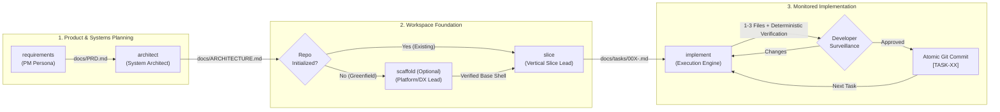

# Spec-Driven Development (SDD) Playbook

> **Build robust, production-grade applications with any Agentic AI (Antigravity, Claude Code, Cursor, Codex, Windsurf) through deterministic, file-backed engineering workflows.**

---

## 1. What is Spec-Driven Development (SDD)?

When given open-ended instructions like *"Build me an Uber for Laundry"*, AI agents tend to jump straight into coding. They will attempt to generate 30+ files simultaneously, hallucinate database relationships, invent incompatible API payloads, get stuck in endless linter errors, and eventually exhaust the context window.

**Spec-Driven Development (SDD)** solves this by enforcing strict architectural separation of concerns. Instead of relying on volatile conversational memory, the software development lifecycle is broken down into **5 distinct phases**. Each phase is powered by a specialized skill, constrained by token budgets, and backed by a version-controlled Markdown artifact stored in the repo.



---

## 2. The 5 Core Skills Breakdown

| Skill | Role | Primary Artifact | Input Dependency | Output Scope & Boundaries |
|---|---|---|---|---|
| **`requirements`** | Principal Product Manager | `docs/PRD.md` (150–250 lines) | User idea or prompt | Actor $\times$ Surface matrix, scale tier, hard cap of 3–5 `P0 (MVP)` features with Gherkin acceptance criteria. **Zero tech stack or code decisions.** |
| **`architect`** | Principal Systems Architect | `docs/ARCHITECTURE.md` (250–380 lines) | `docs/PRD.md` | 7-layer stack taxonomy, Mermaid system & ER diagrams, database schemas, API summary endpoints, repo topology, operational scale strategy. **Zero feature writing or task planning.** |
| **`scaffold`** *(Optional)* | Principal Platform & DX Engineer | Base workspace & tools, `AGENTS.md`, `docs/rules/` | `docs/ARCHITECTURE.md` | Runs non-interactive official CLIs (`create-next-app`, `@nestjs/cli`, `create-vite`, `uv`, etc.), wires workspace/monorepo manifests, sets up Biome/Commitlint/Husky/Docker, installs packages, runs verification, and makes 1 foundation commit. **Zero feature code.** |
| **`slice`** | Vertical Slice Architect | `docs/tasks/README.md` & `docs/tasks/00X-<slug>.md` | `docs/PRD.md` & `docs/ARCHITECTURE.md` | Decomposes a single feature into sequential, atomic microtasks strictly capped at **1–3 target files** with deterministic CLI verification commands and `TO_DO` status. **Zero application code.** |
| **`implement`** | Principal Implementation Specialist | Application code files + atomic commits | `docs/tasks/00X-<slug>.md` & `docs/rules/` | Executes strictly **ONE** microtask at a time, modifies only the 1–3 target files, runs the verification command (max 3 auto-fix attempts), renders the **Surveillance Review Card**, updates status to `COMPLETED`, and commits only after developer approval. |

---

## 3. End-to-End Workflow & Prompt Examples

Here is how to run the skills in sequence for a complete project lifecycle.

### Phase 1: Requirements Discovery (`requirements`)
*Define what to build and why, without discussing tech stacks.*

**Prompt:**
```text
Activate the requirements skill. I want to build an on-demand doorstep laundry & dry cleaning service called "CleanFlow". 
It needs surfaces for Customers to book pickups, Riders to navigate and accept laundry batches, and an Admin portal to manage hub operations.
```
- **What happens:** The agent synthesizes the ecosystem, maps the actors to surfaces, and asks **2–3 focused questions** (pricing model, delivery verification, MVP trade-offs) using multiple-choice options.
- **Output:** Creates `docs/PRD.md` with features `FEAT-01` through `FEAT-05` and scale tier `Case 1: 1–10k Users`.

---

### Phase 2: System Architecture Design (`architect`)
*Translate product requirements into technical blueprints and data models.*

**Prompt:**
```text
Activate the architect skill. Review docs/PRD.md and design the full system architecture, data models, and repository topology.
```
- **What happens:** The agent extracts the PRD surfaces and scale profile. It asks **Turn 1: Primary Ecosystem** (e.g. TypeScript Full-Stack Monorepo) and **Turn 2: Cross-Cutting Decisions** (Hosting target, Auth strategy).
- **Output:** Generates `docs/ARCHITECTURE.md` complete with Mermaid diagrams, PostgreSQL schemas, API contracts, Turborepo structure, and Day-1 operational infra (PgBouncer, S3 presigned uploads, Redis BullMQ).

---

### Phase 3: Project Tooling & Foundation Setup (`scaffold`)
*(Optional: Run only when starting a greenfield project or initializing a missing surface).*

**Prompt:**
```text
Activate the scaffold skill. Review docs/ARCHITECTURE.md and initialize the complete monorepo workspace, application shells, and tooling guardrails.
```
- **What happens:**
  1. Executes official CLIs with non-interactive flags (`create-next-app` for `apps/web`, `@nestjs/cli` for `apps/api`, `create-vite` for `apps/admin`).
  2. Wires root `pnpm-workspace.yaml`, `turbo.json`, and shared packages (`packages/database`, `packages/contracts`, `packages/tsconfig`).
  3. Sets up `commitlint.config.mjs`, Biome, Husky hooks, `docker-compose.yml`, `AGENTS.md`, and `docs/rules/`.
  4. Runs `pnpm install` and verifies `typecheck` and `lint` pass (`Exit code: 0`).
  5. Presents the **Scaffold Review Card** and halts for approval before creating the initial git commit.

---

### Phase 4: Feature Vertical Slicing (`slice`)
*Decompose a feature into sequential microtasks.*

**Prompt:**
```text
Activate the slice skill. Slice the user authentication and onboarding feature (FEAT-01) from docs/PRD.md into atomic microtasks.
```
- **What happens:** The agent asks 2–3 domain-deepening questions (e.g., token lifetime, rate limits, session invalidation), updates `docs/tasks/README.md`, and generates `docs/tasks/001-user-authentication.md`.
- **Output:** A vertical slice with 7–12 microtasks (`TASK-01` to `TASK-0N`), tracing from DB migrations and DTOs up to UI presentation and smoke tests. Every task is capped at 1–3 files with a verification command and set to `TO_DO`.

---

### Phase 5: Disciplined Microtask Implementation (`implement`)
*Execute one microtask under active surveillance.*

**Prompt:**
```text
Activate the implement skill and execute the next task in the active slice.
```
- **What happens:**
  1. Checks prerequisites, verifies previous tasks are completed, and marks `TASK-01` as `IN_PROGRESS`.
  2. Reads only `AGENTS.md`, `docs/rules/`, and the 1–3 target files (plus read-only direct imports).
  3. Implements the code change adhering to architectural rules.
  4. Executes the deterministic verification command (e.g., `pnpm tsc --noEmit` or `vitest`). Self-heals up to 3 times without weakening tests or silencing errors.
  5. Renders the **Developer Surveillance Review Card** and **HALTS**.
  6. When the developer selects **`[A] Commit & Continue`**, the agent updates task status to `COMPLETED`, stages only the Task Change Set, commits with a Commitlint message (`feat(auth): [TASK-01] ...`), and moves to `TASK-02`.

---

## 4. Real-World Scenarios & Lifecycles

### Scenario A: Greenfield Project (From Scratch to Production)
*You have a brand-new idea and an empty repository.*

1. Run **`requirements`** ➔ Generates `docs/PRD.md`.
2. Run **`architect`** ➔ Generates `docs/ARCHITECTURE.md`.
3. Run **`scaffold`** ➔ Creates monorepo shells, installs dependencies, wires rules, verifies clean build, and commits foundation.
4. Run **`slice`** for `FEAT-01` ➔ Generates `docs/tasks/001-<slug>.md`.
5. Run **`implement`** repeatedly until all microtasks in Slice 001 are `COMPLETED`.
6. Run **`slice`** for `FEAT-02` ➔ Repeat implementation loop.

---

### Scenario B: Adding a Feature to an Existing Codebase
*You already have a working app/monorepo and want to add a major new capability.*

1. Run **`requirements`** (runs in **Mode B/C**):
   - Audits existing code entry points, confirms existing features, and appends `FEAT-06` to `docs/PRD.md`.
2. Run **`architect`**:
   - Updates `docs/ARCHITECTURE.md` with new database entities, endpoints, and packages required for `FEAT-06`.
3. **Skip `scaffold`** (workspace tooling already exists).
4. Run **`slice`**:
   - Selects `FEAT-06` and writes `docs/tasks/00X-<feature-slug>.md`.
5. Run **`implement`**:
   - Executes the new slice one microtask at a time.

---

### Scenario C: Requirements Change Mid-Flight
*While implementing Slice 002, business logic or API contracts need to change.*

1. **Pause `implement`**: Do not write ad-hoc code that diverges from the specs.
2. Run **`requirements`** in update mode to record the new acceptance criteria or edge case in `docs/PRD.md`.
3. Run **`architect`** to adjust the data model or endpoint in `docs/ARCHITECTURE.md`.
4. Update the remaining `TO_DO` tasks in `docs/tasks/002-<slug>.md` to reflect the updated target files or contracts.
5. Resume **`implement`** on the next `TO_DO` task.

---

## 5. Core Rules & Guardrails Cheat Sheet

### 1. The 1–3 File Hard Cap
`implement` is strictly forbidden from modifying 4 or more files in a single microtask. If an extra file is truly needed (e.g., an unexported enum in a shared package):
- The agent halts immediately.
- It triggers the **4th-File Deviation Protocol**.
- It presents a formal request with technical justification and awaits explicit developer consent.
- *Bookkeeping files (`docs/tasks/*`) are exempt from this limit.*

### 2. Testing & Verification Integrity
When verification fails, the agent may auto-fix up to **3 times**. However, the agent is strictly forbidden from:
- Deleting, commenting out, or skipping tests (`.skip`, `xit`, `@Disabled`).
- Weakening assertions to force a passing status.
- Silencing type or linter errors using `@ts-ignore`, `eslint-disable`, or `any` casts.
- Passing `--no-verify` to bypass Git commit hooks.

### 3. Clear Status Ownership
- **Slices:** `Not Sliced` ➔ `Planned` *(set by `slice`)* ➔ `In Progress` ➔ `Completed` *(set by `implement`)*. Only **one** slice may be `In Progress` at any time.
- **Microtasks:** `TO_DO` *(set by `slice`)* ➔ `IN_PROGRESS` *(set by `implement` during work/review)* ➔ `COMPLETED` *(set by `implement` upon developer approval)*.

---

## 6. Recommended Slash Commands

Integrate these slash commands during development for optimal speed:

- **`/plan`**: Use when you need a high-level strategic overview of a complex feature before invoking `slice`.
- **`/grill-me`**: Use after running `requirements` or `architect` to let the AI interview you and stress-test edge cases, concurrency locks, and failure recovery.
- **`/compact`**: Use after completing an entire vertical slice to clear conversational memory while keeping disk specifications intact.
- **`/learn`**: Use when you correct an agent on specific repository conventions so future `implement` sessions remember your preferences.
