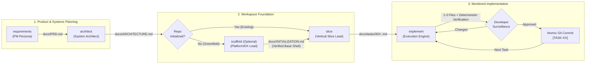

# Spec-Driven Development (SDD) Playbook

> **Build robust, production-grade applications with any Agentic AI (Antigravity, Claude Code, Cursor, Codex, Windsurf) through deterministic, file-backed engineering workflows.**

---

## 1. What is Spec-Driven Development (SDD)?

When given open-ended instructions like *"Build me an Uber for Laundry"*, AI agents tend to jump straight into coding. They will attempt to generate 30+ files simultaneously, hallucinate database relationships, invent incompatible API payloads, get stuck in endless linter errors, and eventually exhaust the context window.

**Spec-Driven Development (SDD)** solves this by enforcing strict architectural separation of concerns. Instead of relying on volatile conversational memory, the software development lifecycle is broken down into **5 distinct phases**. Each phase is powered by a specialized skill, constrained by token budgets, and backed by a version-controlled Markdown artifact stored in the repo.



---

## 2. The 5 Core Skills Breakdown

| Skill | Role | Primary Artifact | Input Dependency | Output Scope & Boundaries |
|---|---|---|---|---|
| **`requirements`** | Principal Product Manager | `docs/PRD.md` (150–250 lines) | User idea or prompt | Actor $\times$ Surface matrix, scale tier, hard cap of 3–5 `P0 (MVP)` features with Gherkin acceptance criteria. **Zero tech stack or code decisions.** |
| **`architect`** | Principal Systems Architect | `docs/ARCHITECTURE.md` (250–380 lines) | `docs/PRD.md` | 7-layer stack taxonomy, Mermaid system & ER diagrams, database schemas, API summary endpoints, repo topology, operational scale strategy. **Zero feature writing or task planning.** |
| **`scaffold`** *(Optional)* | Principal Platform & DX Engineer | `docs/INITIALIZATION.md`, base workspace, `AGENTS.md`, `docs/rules/` | `docs/ARCHITECTURE.md` | Interrogates developer for surface parameters, writes `docs/INITIALIZATION.md` foundation board, executes non-interactive CLIs, pre-links `@repo/*` packages, applies modular `templates/`, verifies clean build, and halts for foundation commit. **Zero feature code.** |
| **`slice`** | Vertical Slice Architect | `docs/tasks/README.md` & `docs/tasks/00X-<slug>.md` | `docs/PRD.md` & `docs/ARCHITECTURE.md` | Decomposes a single feature into sequential, atomic microtasks strictly capped at **1–3 target files** with deterministic CLI verification commands and `TO_DO` status. **Zero application code.** |
| **`implement`** | Principal Implementation Specialist | Application code files + atomic commits | `docs/tasks/00X-<slug>.md` & `docs/rules/` | Executes strictly **ONE** microtask at a time, modifies only the 1–3 target files, runs the verification command (max 3 auto-fix attempts), renders the **Surveillance Review Card**, updates status to `COMPLETED`, and commits only after developer approval. |

---

## 3. Skill-by-Skill Prompting Guide

To get the most out of each skill, prompts must be clear, bounded, and reference the right artifacts. Below is a guide for every phase showing what works, what fails, and why.

---

### Phase 1: Requirements Discovery (`requirements`)
*Define what to build and why, without discussing tech stacks or code.*

#### ❌ The Bad Prompt (Anti-Pattern)
```text
Build me an Uber for Laundry with a Next.js frontend, PostgreSQL database, and Tailwind CSS.
```
> **Why it fails:** Blends technical architecture into product discovery. The agent skips feature definition, hallucinates database columns prematurely, and fails to identify critical actors, business constraints, or edge cases.

#### ✅ The High-Impact Prompt
```text
Activate the requirements skill. I want to build an on-demand doorstep laundry service called "CleanFlow".

Product Surfaces & Actors:
- Customers: Book pickups, select garment care preferences, track live status, pay online.
- Delivery Riders: Accept route batches, verify bag barcodes at doorsteps, mark drop-offs.
- Facility Admins: Batch-process garments by wash type, track machine capacity, handle damage flags.

Focus strictly on core P0 MVP features. Do not discuss tech stacks, databases, or code yet.
```

* **📌 What to Include:** Target actors, client surfaces, core business model/revenue flows, operational constraints, and a hard instruction to keep tech stack out of the PRD.
* **⚠️ What to Avoid:** Mentioning programming languages, frameworks, ORMs, libraries, or table schemas.

---

### Phase 2: System Architecture Design (`architect`)
*Translate product requirements into technical blueprints, data models, and operational infrastructure.*

#### ❌ The Bad Prompt (Anti-Pattern)
```text
Design the architecture for my app and write the database models in Prisma.
```
> **Why it fails:** Jumps directly into implementation syntax. The agent generates partial code files that haven't been planned, skipping essential architectural layers like connection pooling, reverse proxying, cache invalidation, and repo topology.

#### ✅ The High-Impact Prompt
```text
Activate the architect skill. Review docs/PRD.md and design the 7-layer architecture, data models, and repository topology.

Architectural Preferences:
- Ecosystem: TypeScript Full-Stack Monorepo (Next.js App Router + NestJS API + Turborepo).
- Scale Target: Case 1 (1–10k users; Single VPS with Docker Compose, Nginx, PgBouncer, and Redis BullMQ).
- Auth Strategy: Session-based HTTP-only cookies with RBAC (Customer, Rider, Admin).
- Database: PostgreSQL with Drizzle ORM and Zod runtime validation.
```

* **📌 What to Include:** Explicit reference to `docs/PRD.md`, preferred ecosystem anchor, scale tier target (Case 1 vs Case 2), hosting preferences, and auth strategy.
* **⚠️ What to Avoid:** Asking for feature application code; inventing features not present in `docs/PRD.md`.

---

### Phase 3: Foundation Tooling & Workspace Setup (`scaffold`)
*(Optional: Run only on greenfield repositories or when initializing a brand new surface).*

#### ❌ The Bad Prompt (Anti-Pattern)
```text
Run scaffold and set up everything.
```
> **Why it fails:** Forces the agent to guess minute flags (e.g., Tailwind vs Vanilla, port assignments, linter presets). The agent runs generic CLIs, then spends hundreds of tokens overwriting CSS and config files, leading to port collisions and broken linters.

#### ✅ The High-Impact Prompt
```text
Activate the scaffold skill. Review docs/ARCHITECTURE.md and generate docs/INITIALIZATION.md.

Tactical Preferences:
- Package Manager: pnpm (v9) with Turborepo.
- Frontend (apps/web): Next.js App Router + Tailwind CSS + shadcn/ui (Neutral palette) with src/ directory.
- Backend (apps/api): NestJS strict shell.
- Tooling Preset: Biome preset (from templates/linters/biome.json) + .editorconfig + GitHub Actions CI.
- Local Ports: PostgreSQL on 5432, Redis on 6379 (no collisions).

Present docs/INITIALIZATION.md for my review before executing any terminal commands.
```

* **📌 What to Include:** Styling/component combo (`Tailwind + shadcn/ui`), package manager, port assignments, linter preset preference, and an explicit instruction to present `docs/INITIALIZATION.md` before execution.
* **⚠️ What to Avoid:** Letting the agent execute commands without an approved `docs/INITIALIZATION.md`; writing business feature code.

---

### Phase 4: Feature Vertical Slicing (`slice`)
*Decompose a single PRD feature into atomic, verifiable microtasks.*

#### ❌ The Bad Prompt (Anti-Pattern)
```text
Slice all features in docs/PRD.md into tasks and start implementing them.
```
> **Why it fails:** Overwhelms the context window by trying to plan 50+ tasks at once. Specs become obsolete before later tasks are even started.

#### ✅ The High-Impact Prompt
```text
Activate the slice skill. Slice FEAT-01 (User Authentication & Session Management) from docs/PRD.md into atomic microtasks.

Rules:
- Strictly obey the 1–3 target file limit per task.
- Trace sequentially: Contracts -> DB Schema -> Domain Service -> HTTP Controller -> UI Components.
- Assign a deterministic CLI verification command to every task (e.g., pnpm tsc --noEmit, vitest).
```

* **📌 What to Include:** The single target Feature ID (`FEAT-01`), strict 1–3 file cap reminder, sequential layer flow, and mandatory verification commands for each task.
* **⚠️ What to Avoid:** Slicing multiple features simultaneously; creating speculative tasks for features outside `FEAT-01`.

---

### Phase 5: Disciplined Microtask Implementation (`implement`)
*Execute strictly one microtask at a time under developer surveillance.*

#### ❌ The Bad Prompt (Anti-Pattern)
```text
Finish the authentication slice.
```
> **Why it fails:** The agent attempts to complete 8 tasks in a single turn without compiling or testing. It skips error handling, makes unverified Git commits, and generates broken imports across packages.

#### ✅ The High-Impact Prompt
```text
Activate the implement skill. Inspect docs/tasks/001-user-authentication.md and execute the next TO_DO task (TASK-02).

Discipline:
- Modify ONLY the 1–3 declared target files.
- Adhere to docs/rules/code-standards.md and docs/rules/testing-integrity.md.
- Run the task's verification command and self-heal if it fails (max 3 attempts).
- Render the Developer Surveillance Review Card and HALT for my approval before committing.
```

* **📌 What to Include:** Active slice file path, target task number, strict adherence to `docs/rules/`, and explicit instruction to render the review card and halt for approval.
* **⚠️ What to Avoid:** Asking for multiple tasks at once; asking the agent to bypass failing checks (`--no-verify`, `@ts-ignore`, or commenting out tests).

---

## 4. The SDD Prompt Engineering Playbook: Dos & Don'ts

Use this cheat sheet to ensure prompts keep agents on track without token waste.

### 📋 The Golden Rules of SDD Prompting

| Dimension | ✅ What to Include | ❌ What to Avoid |
|---|---|---|
| **Context Anchoring** | Reference exact disk paths: `docs/PRD.md`, `docs/ARCHITECTURE.md`, `docs/tasks/00X-*.md`. | Assuming the agent remembers conversations from previous sessions or skills. |
| **Scope Bounding** | Strictly 1 feature per slice (`FEAT-01`), strictly 1 task per implementation (`TASK-02`). | Asking the agent to *"build the feature and connect it to everything"*. |
| **Separation of Concerns** | Problem space in Phase 1; Solution space in Phase 2; Foundation in Phase 3. | Blending tech stack and libraries into product requirements discovery. |
| **Tactical Parameterization** | Concrete flags (ports, Tailwind, shadcn palette, package manager) upfront. | Letting the agent use default CLI flags, then rewriting code files later. |
| **Verification Gates** | Explicit CLI verification command: `pnpm typecheck`, `pnpm test`, `biome check`. | Telling the agent to *"just write the code"* without proving it compiles. |
| **Surveillance & Commit** | Review cards (`INITIALIZATION.md`, Review Card) + developer approval. | Allowing automated, silent Git commits without seeing the diff first. |

---

### 🚫 The 5 Most Dangerous Prompting Anti-Patterns

#### 1. Phase-Jumping
* **The Mistake:** Asking an agent in the `requirements` or `architect` phase to *"also write the starter code"*.
* **Why it breaks:** Bypasses task slicing and guardrail rules. The agent writes unverified code without tests, leading to broken imports and unmaintainable technical debt.

#### 2. The "Vague Mega-Prompt"
* **The Mistake:** *"Create a real-time messaging system with websockets."*
* **Why it breaks:** The agent tries to implement socket handlers, database tables, Redis adapters, and UI components in one pass. It modifies 15+ files, loses context, and produces half-baked code.

#### 3. Micromanaging Implementation Syntax
* **The Mistake:** Copy-pasting massive blocks of TypeScript code into your prompt and telling the agent to *"insert this here"*.
* **Why it breaks:** Destroys your context window tokens. Let the agent read the contracts from disk and write the code adhering to `docs/rules/code-standards.md`.

#### 4. Bypassing Quality Gates Under Pressure
* **The Mistake:** *"Tests are failing, just comment them out or use `@ts-ignore` so we can commit."*
* **Why it breaks:** Violates `docs/rules/testing-integrity.md`. Cheating tests causes cascade failures on subsequent tasks that depend on those assertions.

#### 5. Silent Multi-Task Batching
* **The Mistake:** *"Run implement on tasks 3, 4, and 5 together."*
* **Why it breaks:** Defeats the purpose of atomic Git commits. If Task 5 breaks, you cannot cleanly roll back Task 5 without losing Task 3 and Task 4.

---

## 5. Real-World Lifecycles & Scenarios

### Scenario A: Greenfield Project (From Scratch to Production)
*You have a brand-new idea and an empty repository.*

1. Run **`requirements`** ➔ Generates `docs/PRD.md`.
2. Run **`architect`** ➔ Generates `docs/ARCHITECTURE.md`.
3. Run **`scaffold`** ➔ Generates `docs/INITIALIZATION.md`, executes foundation board step-by-step, verifies clean build, and commits foundation.
4. Run **`slice`** for `FEAT-01` ➔ Generates `docs/tasks/001-<slug>.md`.
5. Run **`implement`** repeatedly until all microtasks in Slice 001 are `COMPLETED`.
6. Run **`slice`** for `FEAT-02` ➔ Repeat implementation loop.

---

### Scenario B: Adding a Feature to an Existing Codebase
*You already have a working app/monorepo and want to add a major new capability.*

1. Run **`requirements`** (runs in **Mode B/C**):
   - Audits existing code entry points, confirms existing features, and appends `FEAT-06` to `docs/PRD.md`.
2. Run **`architect`**:
   - Updates `docs/ARCHITECTURE.md` with new database entities, endpoints, and packages required for `FEAT-06`.
3. **Skip `scaffold`** (workspace tooling already exists).
4. Run **`slice`**:
   - Selects `FEAT-06` and writes `docs/tasks/00X-<feature-slug>.md`.
5. Run **`implement`**:
   - Executes the new slice one microtask at a time.

---

### Scenario C: Requirements Change Mid-Flight
*While implementing Slice 002, business logic or API contracts need to change.*

1. **Pause `implement`**: Do not write ad-hoc code that diverges from the specs.
2. Run **`requirements`** in update mode to record the new acceptance criteria or edge case in `docs/PRD.md`.
3. Run **`architect`** to adjust the data model or endpoint in `docs/ARCHITECTURE.md`.
4. Update the remaining `TO_DO` tasks in `docs/tasks/002-<slug>.md` to reflect the updated target files or contracts.
5. Resume **`implement`** on the next `TO_DO` task.

---

## 6. Core Rules & Guardrails Cheat Sheet

### 1. The 1–3 File Hard Cap
`implement` is strictly forbidden from modifying 4 or more files in a single microtask. If an extra file is truly needed (e.g., an unexported enum in a shared package):
- The agent halts immediately.
- It triggers the **4th-File Deviation Protocol**.
- It presents a formal request with technical justification and awaits explicit developer consent.
- *Bookkeeping files (`docs/tasks/*`) are exempt from this limit.*

### 2. Testing & Verification Integrity
When verification fails, the agent may auto-fix up to **3 times**. However, the agent is strictly forbidden from:
- Deleting, commenting out, or skipping tests (`.skip`, `xit`, `@Disabled`).
- Weakening assertions to force a passing status.
- Silencing type or linter errors using `@ts-ignore`, `eslint-disable`, or `any` casts.
- Passing `--no-verify` to bypass Git commit hooks.

### 3. Clear Status Ownership
- **Slices:** `Not Sliced` ➔ `Planned` *(set by `slice`)* ➔ `In Progress` ➔ `Completed` *(set by `implement`)*. Only **one** slice may be `In Progress` at any time.
- **Microtasks:** `TO_DO` *(set by `slice`)* ➔ `IN_PROGRESS` *(set by `implement` during work/review)* ➔ `COMPLETED` *(set by `implement` upon developer approval)*.

---

## 7. Recommended Slash Commands

Integrate these slash commands during development for optimal speed:

- **`/plan`**: Use when you need a high-level strategic overview of a complex feature before invoking `slice`.
- **`/grill-me`**: Use after running `requirements` or `architect` to let the AI interview you and stress-test edge cases, concurrency locks, and failure recovery.
- **`/compact`**: Use after completing an entire vertical slice to clear conversational memory while keeping disk specifications intact.
- **`/learn`**: Use when you correct an agent on specific repository conventions so future `implement` sessions remember your preferences.
