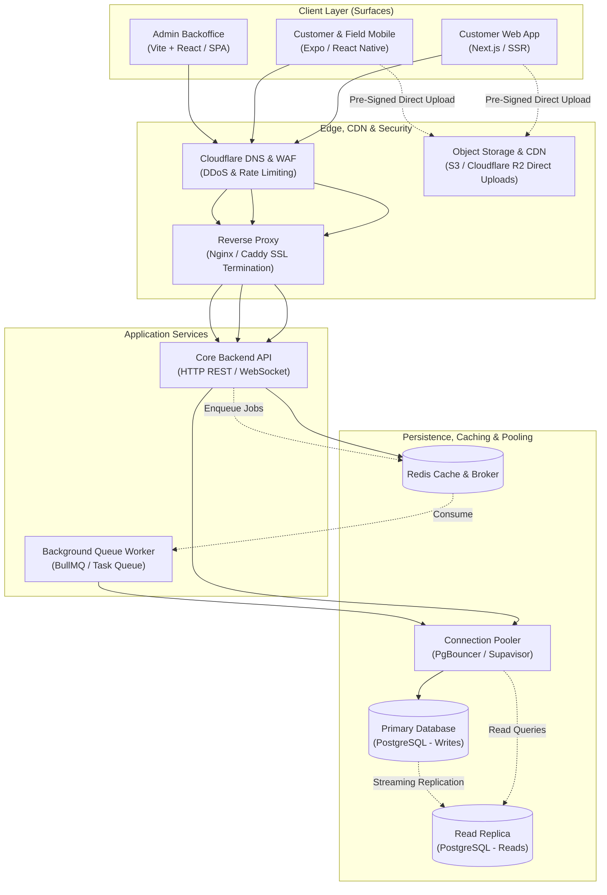
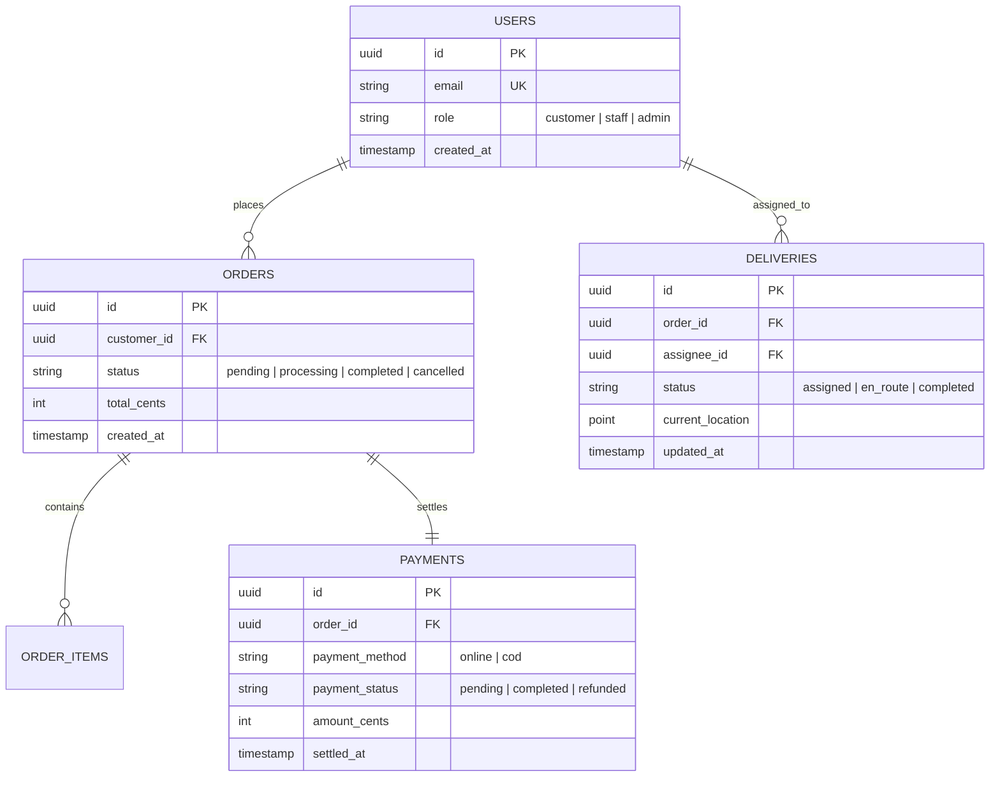

# System Architecture Reference Template

Use this template to generate or update `docs/ARCHITECTURE.md`.

> **Output Constraints:**
> - **Target Length:** **250–380 lines** total.
> - **7-Layer Stack Coverage:** Explicitly document the stack across the 7 layers (Languages, Backend, Frontend, Data/ORM/Validation, Tooling, State/UI, and Testing/Guardrails).
> - **Operational Infrastructure & Scale Tier:** Document hosting, reverse proxy, S3 presigned direct uploads, connection pooling (PgBouncer), message queues (BullMQ/Kafka), and backups based on the scale tier (Case 1: 1–10k users vs. Case 2: 10k–100k users).
> - **Mermaid Diagrams:** Include a High-Level System Architecture Diagram (`flowchart TD`) and Core Data Model ER Diagram (`erDiagram`).
> - **Data & API Specs:** Detail database entities with constraints/indexes and high-level API endpoint summaries mapped to PRD Feature IDs (`FEAT-XX`).

---

````markdown
# System Architecture: <Product Name>

## 1. Architecture Overview & 7-Layer Stack Matrix
- **Derived from PRD:** [`docs/PRD.md`](./PRD.md)
- **Target Scale Stage:** <e.g., Case 1: 1–10k Users (Baseline Production) | Case 2: 10k–100k Users (Hardened HA)>
- **Architecture Pattern:** <e.g., Turborepo Monorepo (Apps + Packages) / Modular Monolith / Client-API Split>

### 1.1 Technology Stack Matrix (7 Layers)
| Layer | Decision / Technology | Rationale & Trade-Off |
|---|---|---|
| **1. Language & Runtime** | <e.g., TypeScript / Node.js 22 LTS or Go 1.23 or Python 3.12> | <e.g., End-to-end type safety across web, mobile, and API> |
| **2. Backend Framework** | <e.g., NestJS (Enterprise Modular) or Fastify/Hono or Go Fiber or FastAPI> | <e.g., Strict module encapsulation & dependency injection> |
| **3. Frontend Frameworks** | <Customer: Next.js (SSR/SEO) \| Admin: React + Vite (SPA) \| Mobile: Expo> | <Customer needs SEO/web sharing; Admin is pure authenticated SPA> |
| **4. Data Layer & Validation** | <PostgreSQL + Drizzle ORM + Zod / Valibot (or sqlc / Pydantic)> | <Zero runtime overhead, SQL-like query builder, type-safe schema inference> |
| **5. Tooling & Compilers** | <pnpm + Turborepo + Biome (Linter/Formatter) + Tailwind CSS> | <Sub-second linting, hard-link package caching, utility-first styling> |
| **6. Frontend State & UI** | <TanStack Query (Server State) + Zustand (UI State) + shadcn/ui> | <Clean separation of async cache from local UI drawers/modals> |
| **7. Testing & Quality DX** | <Vitest (Unit) + Playwright (E2E) + Testcontainers + Husky/Commitlint> | <Real disposable Postgres containers in CI; zero flaky DOM mocks> |

---

## 2. High-Level System Architecture Diagram



---

## 3. Data Model & Schema Specifications

### 3.1 Entity Relationship Diagram (`erDiagram`)


### 3.2 Database Table Specifications & Constraints
| Table Name | Enums / Constraints | Indexes | Foreign Keys & Cascade Rules | Audit Columns |
|---|---|---|---|---|
| `users` | `role IN ('customer', 'staff', 'admin')` | `UNIQUE(email)`, `INDEX(role)` | None | `created_at`, `updated_at` |
| `orders` | `status IN ('pending', 'processing', 'completed', 'cancelled')` | `INDEX(customer_id, created_at DESC)` | `customer_id -> users.id (RESTRICT)` | `created_at`, `updated_at` |
| `deliveries` | `status IN ('assigned', 'en_route', 'completed')` | `INDEX(assignee_id, status)` | `order_id -> orders.id (CASCADE)`, `assignee_id -> users.id (RESTRICT)` | `created_at`, `updated_at` |
| `payments` | `payment_status IN ('pending', 'completed', 'refunded')` | `UNIQUE(order_id)` | `order_id -> orders.id (RESTRICT)` | `settled_at`, `created_at` |

---

## 4. API Boundaries & Summary Endpoints
*(High-level endpoint contracts mapped to PRD Feature IDs)*

| Feature ID | Method | Endpoint Path | Client Surface | Auth Required | Description |
|---|---|---|---|---|---|
| `FEAT-01` | `POST` | `/v1/uploads/presign` | Customer / Rider | Yes | Generate pre-signed direct upload URL for S3/R2 |
| `FEAT-01` | `POST` | `/v1/orders` | Customer (Web/Mobile) | Yes (Customer) | Create and schedule a new order |
| `FEAT-01` | `GET` | `/v1/orders/:id` | Customer / Admin | Yes | Fetch order status and live tracking |
| `FEAT-02` | `PATCH` | `/v1/deliveries/:id/location` | Field Mobile | Yes (Staff) | Update live GPS coordinates |
| `FEAT-02` | `POST` | `/v1/deliveries/:id/complete` | Field Mobile | Yes (Staff) | Confirm delivery & cash settlement |
| `FEAT-03` | `GET` | `/v1/admin/orders` | Admin Web | Yes (Admin) | Paginated order stream with state filters |
| `FEAT-04` | `POST` | `/v1/settlements/reconcile` | Admin Web | Yes (Admin) | Daily cash handover reconciliation |

---

## 5. Repository Topology & Folder Structure

```text
.
├── apps/
│   ├── web/                    # Customer web application (Next.js SSR)
│   ├── mobile/                 # Mobile application (Expo / React Native)
│   ├── admin/                  # Backoffice dashboard (React + Vite SPA)
│   └── api/                    # Core backend service & background workers
├── packages/
│   ├── database/               # ORM schema, migrations, and seed scripts
│   ├── contracts/              # Shared runtime validation schemas & DTO types
│   ├── ui/                     # Shared design system components (shadcn/ui)
│   └── tsconfig/               # Shared TypeScript configurations
├── docs/
│   ├── PRD.md                  # Product requirements document
│   └── ARCHITECTURE.md         # System architecture specification
└── package.json
```

---

## 6. Cross-Cutting Concerns & Security
- **Authentication & RBAC:** Stateless JWT access tokens with rotating refresh tokens stored in HTTP-only cookies; role-based guards enforced at the gateway.
- **Data Integrity & Concurrency:** ACID transactions for multi-table updates; unique idempotency keys for payment/order requests.
- **Secrets Management:** Injected via Infisical / Doppler directly into CI/CD build environments and runtime containers.

---

## 7. Operational Infrastructure & Scaling Stage
*(Aligned with Scale Profile: Case 1 vs. Case 2)*

| Component | Target Architecture | Operational Strategy |
|---|---|---|
| **Hosting & Compute** | <e.g., Single VPS ($10–$20/mo Hetzner/DigitalOcean) running Docker Compose or PaaS (Railway/Render)> | Zero-downtime rolling deploys via GitHub Actions (`docker compose up -d --no-deps backend`). |
| **Edge & Reverse Proxy** | Nginx or Caddy | SSL/TLS termination (Let's Encrypt), Brotli compression, rate limiting, and port protection. |
| **Object Storage & CDN** | Cloudflare R2 / AWS S3 + CloudFront | Pre-signed upload URLs: clients upload photos/files directly to R2/S3, bypassing backend CPU/RAM. |
| **DB Connection Pooling** | PgBouncer / Supavisor | Transaction-level pooling maintaining 20 warm connections to prevent pool exhaustion. |
| **Async Queues & Workers** | Redis + BullMQ (or RabbitMQ) | Offloads transactional emails (Resend), image resizing, and push notifications from the HTTP loop. |
| **Observability & Alerts** | Sentry + Uptime Kuma | Real-time crash telemetry with stack traces; automated health pings every 60s alerting Telegram/Slack. |
| **Database Backups & PITR**| pgBackRest / WAL-G (or Managed Automated Backups) | Continuous WAL streaming to S3 for point-in-time recovery to the second before corrupt operations. |
````
