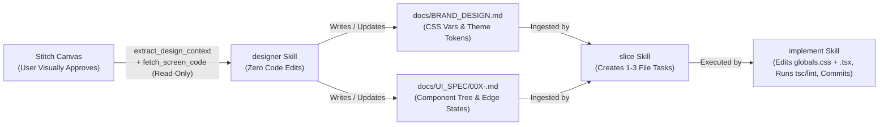

# Google Stitch MCP & Workspace Spec Bridge Reference

This document defines the protocol for orchestrating **Google Stitch** via MCP (Model Context Protocol) and translating visual designs into deterministic specification artifacts (`docs/BRAND_DESIGN.md` and `docs/UI_SPEC/00X-<slug>.md`) that `slice` and `implement` turn into production code without generating AI slop.

---

## 1. Google Stitch MCP Configuration & Connection Guard

Google Stitch exposes an MCP server (`stitch-mcp`) that connects via a Stitch API Key or Google Cloud credentials.

### MCP Configuration Snippet

```json
{
  "mcpServers": {
    "stitch": {
      "command": "npx",
      "args": ["-y", "stitch-mcp"],
      "env": {
        "STITCH_API_KEY": "${STITCH_API_KEY}",
        "GOOGLE_CLOUD_PROJECT": "${GOOGLE_CLOUD_PROJECT}"
      }
    }
  }
}
```

### ⚠️ Offline / Disconnected MCP Guard (Zero Hallucinated Links)
If the `stitch` MCP tools (`list_projects`, `list_screens`, `generate_screen_from_text`, `extract_design_context`, `fetch_screen_code`) are **not exposed** in the current environment or return an authentication error:
1. **NEVER invent or hallucinate fake `https://stitch.withgoogle.com/...` URLs or fake `stitch://screen-xxx` IDs.**
2. **Phase 1 (`docs/BRAND_DESIGN.md`) can still run completely.**
3. Before Phase 2 (Stitch Canvas Generation), halt and inform the developer that `stitch-mcp` is not connected, display the configuration snippet above, and ask whether they want to:
   * Connect `stitch-mcp` and retry, **or**
   * Provide an existing Stitch reference / screenshot manually so `designer` can write `docs/UI_SPEC/00X-<slug>.md`.

---

## 2. Read-Only vs. Generative Stitch MCP Tools

To allow inspecting existing screens while strictly preventing premature prompt generation, Stitch tools are split into two permission tiers:

| Permission Tier | MCP Tool Name | Purpose | When Allowed |
| :--- | :--- | :--- | :--- |
| **🟢 Read-Only** | `list_projects` / `list_screens` | Lists existing Stitch projects and screens on the user's canvas. | **Anytime** (Phase 0, 1, 2, or 3) to inspect existing reference pages. |
| **🟢 Read-Only** | `extract_design_context` | Extracts color tokens, fonts, spacing, and layout DNA from an existing Stitch screen. | **Anytime** (including Phase 1 if the user says *"Extract my brand from my existing Stitch screen"*). |
| **🟢 Read-Only** | `fetch_screen_code` | Fetches structural preview markup from an approved screen to analyze its component hierarchy. | **Phase 3 Only** ( strictly for decomposing into `docs/UI_SPEC/00X-<slug>.md`—never copy raw HTML into code files!). |
| **🔒 Generative** | `generate_screen_from_text` | Prompts Stitch to generate or modify a UI screen on the canvas. | **LOCKED until `docs/BRAND_DESIGN.md` is `🟢 APPROVED` by the user.** |

---

## 3. Cross-Screen Consistency Protocol

When an application has multiple screens (`001-login`, `002-dashboard`, `003-checkout`), designing screens in isolation causes jarring layout drift (different navbars, conflicting card styles, mismatched spacing).

Before calling `generate_screen_from_text` for any screen after `001`:
1. **Read Section 7 (Approved Stitch Screen Registry) of `docs/BRAND_DESIGN.md`** and inspect existing files in `docs/UI_SPEC/`.
2. **Call `list_screens` / `extract_design_context`** on the primary approved anchor screen in the Stitch project.
3. **Lock Shared Shell Parameters in the Prompt:** Explicitly include the established navigation shell (e.g., *"Use the exact same 64px topbar and 260px collapsible left sidebar established in Screen 001"*).

---

## 4. The Zoom-Out-Zoom-In Prompting Framework

When `docs/BRAND_DESIGN.md` is `🟢 APPROVED`, construct the `generate_screen_from_text` prompt using four structured layers:

1. **Context & Actor (Zoom-Out):**
   * Target actor and feature goal from `docs/PRD.md` (e.g., `FEAT-02: Facility Admin Batch Processing Queue`).
   * Surface viewport (`Desktop 1440px Web App` or `Mobile 390px App`).
2. **Brand DNA & Tokens (from `docs/BRAND_DESIGN.md`):**
   * Theme mode, 60-30-10 color hex codes, heading/body/monospace font names, and exact corner radius (`--radius`).
3. **Cross-Screen Shell & Layout Hierarchy (Zoom-In):**
   * Shared navigation shell from prior screens in `docs/UI_SPEC/`.
   * Primary focal zone, secondary panels, data tables, and primary CTA placement.
4. **Non-Happy-Path Visual Cue:**
   * Filter bar, status badges, and clear hierarchy for empty/loading states.

---

## 5. Pure Spec Bridge: How `designer` Connects to `slice` and `implement`



### Stack-Adaptive Token & Component Mapping
Based on `docs/ARCHITECTURE.md` (if present), `designer` formats the specifications in `docs/BRAND_DESIGN.md` and `docs/UI_SPEC/00X-<slug>.md` to match the workspace stack:
* **Tailwind v4 + `shadcn/ui`:** CSS custom properties (`:root`, `.dark`, `@theme inline`) in `globals.css` + `@/components/ui/*` primitives + `next/font/google`.
* **Tailwind v3 + `shadcn/ui`:** HSL variables in `globals.css` + `tailwind.config.ts` theme extension + `@/components/ui/*` primitives.
* **Raw / Modular CSS:** Standard `:root` CSS variables (`var(--primary)`, `var(--surface-card)`) and BEM / CSS Module class contracts.
* **Mobile (Expo / React Native):** NativeWind classes or React Native `StyleSheet` theme token objects.
