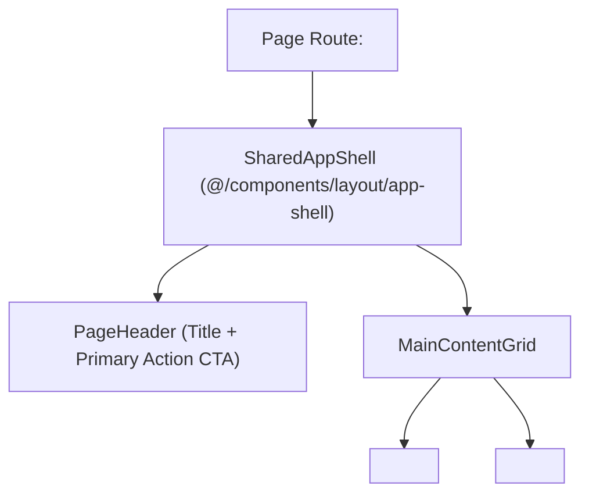

# Screen UI & Component Specification (`docs/UI_SPEC/00X-<screen-slug>.md`)

> **Screen Number:** `00X`  
> **Associated Feature:** `<FEAT-ID: Feature Name from docs/PRD.md>`  
> **Target Surface:** `<e.g., apps/web (Next.js) | apps/admin (Vite) | apps/mobile (Expo)>`  
> **Brand Contract:** [`docs/BRAND_DESIGN.md`](../BRAND_DESIGN.md)  
> **Stitch Screen ID & URL:** `<stitch://screen-id>` ([Open in Google Stitch](https://stitch.withgoogle.com/...))  
> **Visual Approval Status:** `[🟡 PENDING_REVIEW | 🟢 APPROVED_FOR_SLICE]`

---

## 1. Visual Overview & Cross-Screen Continuity

* **Screen Goal:** `<1–2 sentence summary of the user action and outcome on this screen>`
* **Viewport & Breakpoints:** `<e.g., Desktop 1440px (12-col grid) collapsing to Mobile 390px (single-col stack + bottom sheet)>`
* **Cross-Screen Layout Continuity (Shared Shell):**
  * **Referenced Existing Screens:** `<None (First Screen) | e.g., Matches Navbar & 260px Sidebar from docs/UI_SPEC/001-dashboard.md>`
  * **Top Navigation / Header:** `<e.g., Sticky 64px header with border-b border-border and backdrop-blur-md>`
  * **Primary Navigation Shell:** `<e.g., Left collapsible sidebar (Desktop) / Bottom tab bar (Mobile)>`
  * **Main Content Canvas:** `<e.g., max-w-7xl mx-auto px-6 py-8 space-y-6>`

---

## 2. Stitch-to-Workspace Component Hierarchy

*Strict Anti-Slop Rule: Never copy raw exported Stitch HTML into the codebase. `slice` and `implement` must decompose this visual layout into clean, typed components mapped to the project's UI stack in `docs/ARCHITECTURE.md` (e.g., `shadcn/ui`, Tailwind CSS, or modular CSS).*

### Component Mapping Table

| Stitch Visual Zone | Target Workspace Component | UI Library Primitive (`shadcn/ui` / CSS) | Props, Variants & Token Classes |
| :--- | :--- | :--- | :--- |
| `<e.g., Top Action CTA>` | `<CreateBookingButton />` | `@/components/ui/button` | `variant="default"`, `bg-primary text-primary-foreground` |
| `<e.g., KPI Stat Row>` | `<MetricStatCard />` | `@/components/ui/card` | `bg-card border-border rounded-lg p-5`, `font-mono` numbers |
| `<e.g., Status Filter>` | `<OrderFilterTabs />` | `@/components/ui/tabs` or `badge` | Active tab: `bg-primary/10 text-primary border-primary/20` |
| `<e.g., Data Listing>` | `<OrdersDataTable />` | `@/components/ui/table` | Compact density, sticky header, row hover `hover:bg-muted/50` |

---

## 3. Token & Styling Contract (Synced with `docs/BRAND_DESIGN.md`)

* **Canvas & Surfaces:** `bg-background text-foreground` | Raised containers: `bg-card text-card-foreground border border-border`
* **Primary Accent (10% Rule):** `bg-primary text-primary-foreground hover:bg-primary/90 focus-visible:ring-2 focus-visible:ring-ring`
* **Typography Application:**
  * Page Title: `text-2xl font-semibold tracking-tight` (`--font-heading`)
  * Body & Labels: `text-sm text-foreground` / `text-xs text-muted-foreground` (`--font-sans`)
  * IDs, Prices & Metrics: `font-mono tabular-nums` (`--font-mono`)

---

## 4. Mandatory Edge States & Interaction Flows

*`slice` and `implement` must implement all 4 states below—never ship happy-path-only UI:*

1. **Loading / Skeleton State:**
   * `<Describe exact skeleton layout matching the Stitch card/table geometry so zero layout shift (CLS) occurs>`
2. **Empty / Zero-Data State:**
   * `<Describe empty state container, helper message, and primary recovery CTA button>`
3. **Error & Validation State:**
   * `<Describe inline field error styling (text-destructive) and banner/toast error feedback with Retry action>`
4. **Responsive Mobile Behavior (`< 768px`):**
   * `<Describe how multi-column grids, wide tables, or sidebars adapt on mobile viewports>`
