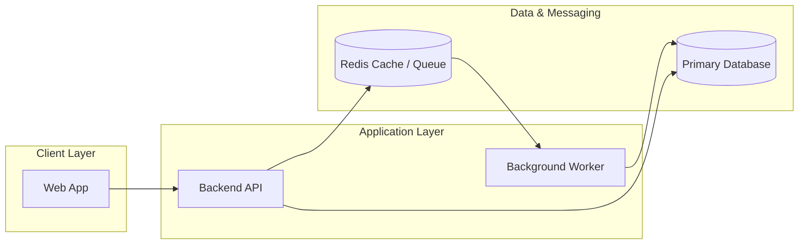
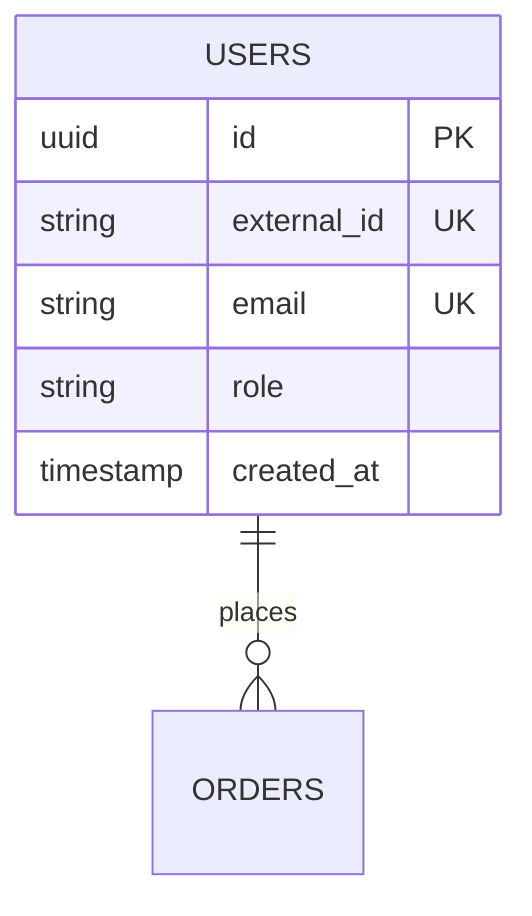
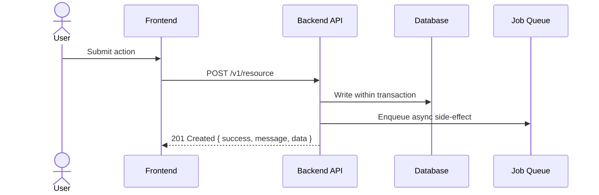

# Documentation Output Templates (`docs/`)

Use these structures when generating the planning documentation after the discovery interview.

---

## 1. `docs/PRD.md` Template

```markdown
# Product Requirements Document (PRD): <Product Name>

## 1. Overview & Problem Statement
- **Problem:** <What pain point this solves>
- **Solution:** <1-2 sentence product summary>

## 2. Target Audience & Scale Expectations
- **Primary Users:** <Personas / roles>
- **Expected Scale:** <Launch user count, 12-month target, peak concurrency, traffic shape>

## 3. Core MVP Features (v1 Scope)
| Feature | User Story | Priority | Key Acceptance Criteria |
|---|---|---|---|
| <Feature 1> | As a <role>, I can <action> so that <benefit> | P0 | <Criteria> |

## 4. Non-Goals (Out of Scope for v1)
- <Explicitly deferred features>

## 5. Risks & Open Questions
- <Key technical or product risks>
```

---

## 2. `docs/ARCHITECTURE.md` Template

```markdown
# System Architecture: <Product Name>

## 1. High-Level System & Cloud Architecture


## 2. Core Data Model (ER Diagram)


## 3. Critical Request & Background Flow


## 4. Technology Stack Summary
| Layer | Choice | Rationale |
|---|---|---|
| Frontend | <Choice> | <Why> |
| Backend | <Choice> | <Why> |
| Database & ORM | <Choice> | <Why> |
| Auth & Security | <Choice> | <Why> |
| Hosting & Infra | <Choice> | <Why> |

## 5. Repository & Folder Layout
```text
<Insert chosen Solo or Monorepo folder tree>
```

## 6. Scaling, Security & Reliability Strategy
- **Auth & Permissions:** <Summary>
- **Caching & Rate Limiting:** <Summary>
- **Backups & Observability:** <Summary>
```

---

## 3. `docs/ROADMAP.md` Template

```markdown
# Implementation Roadmap: <Product Name>

## Phase 1: Foundation & Repository Setup
- [ ] Initialize repository topology, linting, TypeScript, and environment validation
- [ ] Configure database connection, initial schema, and migrations
- [ ] Set up authentication provider and protected route boundaries

## Phase 2: Core Domain & Data Layer
- [ ] Implement core database tables, indexes, and relations
- [ ] Build foundational CRUD APIs and validation schemas

## Phase 3: MVP User Flows & Integrations
- [ ] <MVP Feature 1 end-to-end>
- [ ] <MVP Feature 2 end-to-end>
- [ ] Background jobs, webhooks, and third-party integrations

## Phase 4: Hardening, Testing & Launch
- [ ] Rate limiting, caching, error handling, and health checks
- [ ] End-to-end verification of critical user journeys
- [ ] Production deployment and monitoring setup
```

---

## 4. `docs/adr/00X-<slug>.md` & `docs/adr/README.md` Template

### `docs/adr/README.md`
```markdown
# Architecture Decision Records (ADR)

| ADR | Title | Status | Date |
|---|---|---|---|
| [ADR-001](./001-application-topology.md) | Application Topology | Accepted | YYYY-MM-DD |
| [ADR-002](./002-database-and-orm.md) | Database & ORM Selection | Accepted | YYYY-MM-DD |
```

### `docs/adr/00X-<slug>.md`
```markdown
# ADR-00X: <Decision Title>

- **Status:** Accepted
- **Date:** YYYY-MM-DD

## Context
<What problem, scale requirement, or constraint forced this decision?>

## Options Considered
1. **<Option A (Chosen)>:** <Pros / Cons>
2. **<Option B>:** <Pros / Cons>
3. **<Option C>:** <Pros / Cons>

## Decision
We chose **<Option A>** because <clear rationale tied to user scale and team velocity>.

## Consequences
- **Positive:** <Benefits>
- **Negative / Trade-offs:** <What we must watch out for or revisit at higher scale>
```
