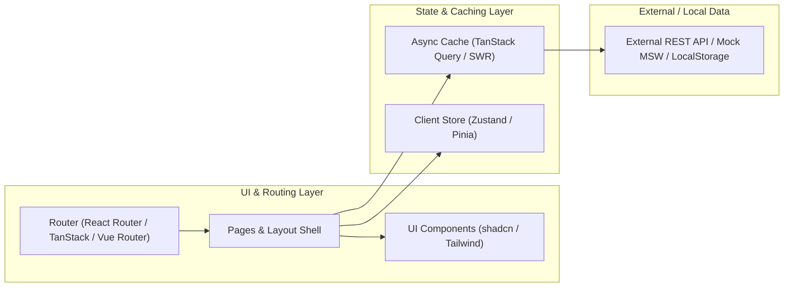
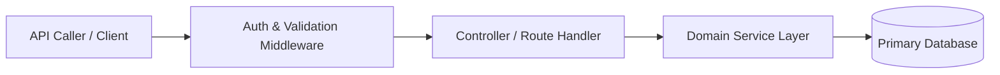
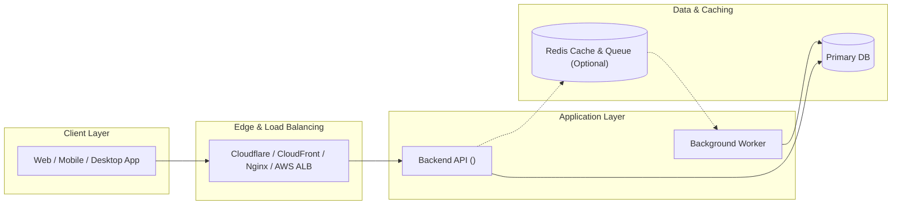
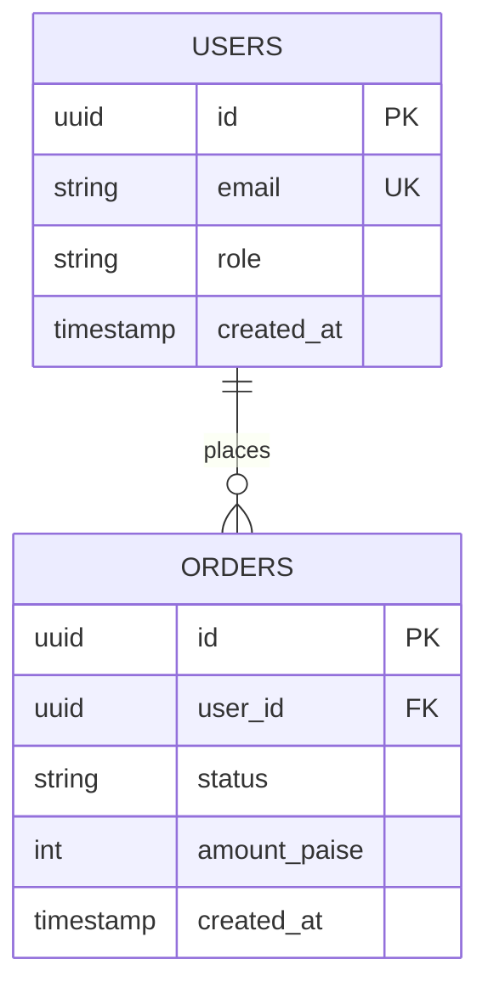
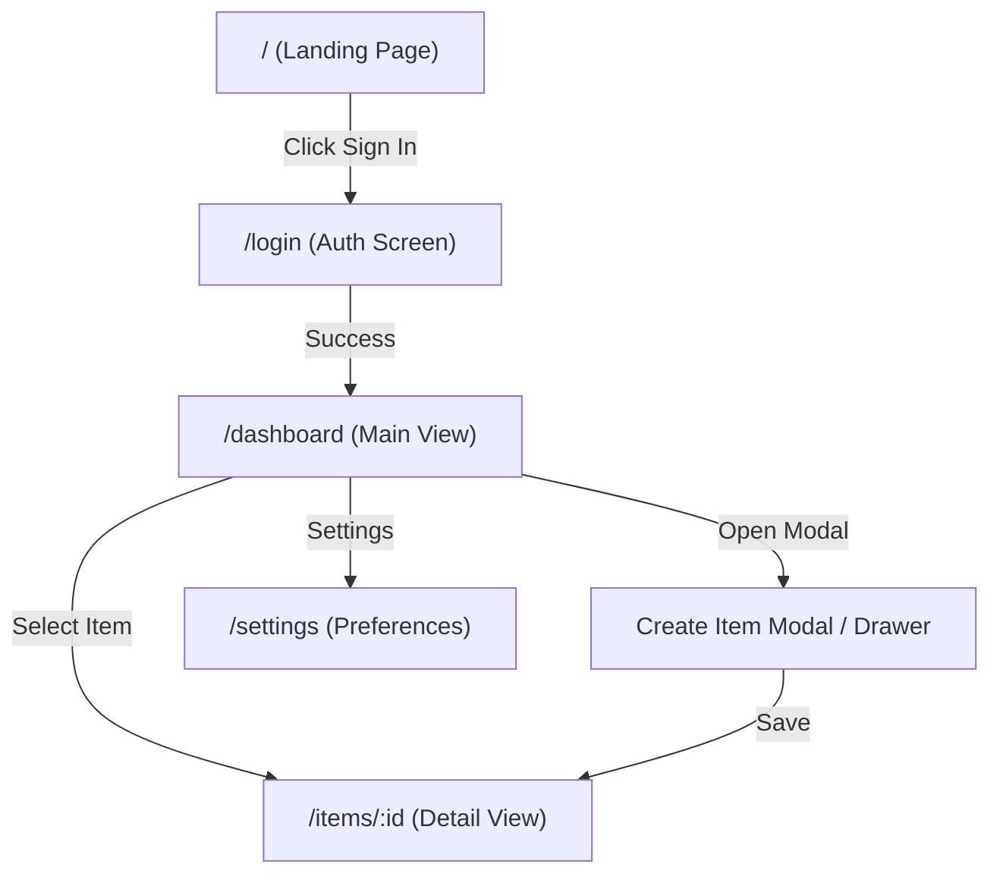
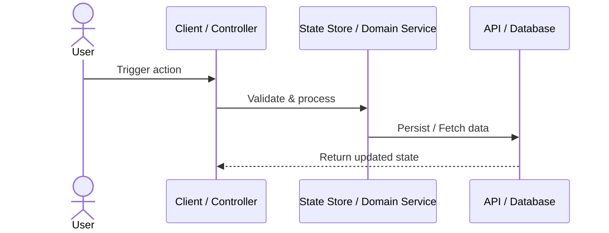

# Documentation Output Templates (`docs/`)

Use these templates when generating the initial `0 → 1` specification suite after the discovery interview.

> **Zero-Duplication `docs/` Structure:**
> ```text
> docs/
> ├── PRD.md                     # Product vision, budget & Feature Registry (P0 / P1 / P2)
> ├── ARCHITECTURE.md            # System diagram, DB schema + constraints, summary endpoints & UI navigation flow
> ├── adr/
> │   ├── README.md              # Architecture Decision Index
> │   └── 001-<slug>.md          # Individual ADR files
> └── tasks/
>     ├── README.md              # Master Task & Phase Index (tracks where every feature started, ended & what's next)
>     └── 00X-<slug>.md          # Individual Feature & 1-3 File Microtask specs (created by feature-planner)
> ```
>
> **Scope Alignment Rule:**
> - **Frontend-Only (e.g., Vite + React / Vue):** Omit backend DB ER diagrams/constraints, backend endpoints, Redis, and cloud load balancers from `ARCHITECTURE.md`. Focus on UI screens, layout shell, page navigation flow, component hierarchy, and client/server state (`SWR`/`TanStack Query`/`Zustand`/`Pinia`).
> - **Backend-Only (e.g., REST API / Microservice):** Omit Frontend Screens & Page Navigation Flow from `ARCHITECTURE.md`. Focus on summary API endpoints, DB schema & constraints table, validation, and service architecture.
> - **Application Code Only (No Cloud/DevOps Scope):** Omit Cloud Hosting, Load Balancers (Nginx/ALB), Docker/CI/CD, and Monthly Cloud Cost sections.
> - **Full-Stack + Cloud Infra:** Include all sections below.

---

## 1. `docs/PRD.md` Template (Includes Feature Registry)

```markdown
# Product Requirements Document (PRD): <Product Name>

## 1. Overview & Project Scope
- **Problem:** <What pain point this solves>
- **Solution:** <1-2 sentence product summary>
- **Project Scope Mode:** <Frontend-Only / Backend-Only / Application Code Only / Full-Stack + Infra>
- **Target Platforms:** <Web (Vite/Next/Vue) / Mobile (Expo/Flutter) / Desktop (Tauri/Electron) / Backend API>

## 2. Target Audience, Scale & Budget Envelope
- **Primary Users:** <Personas / roles>
- **Expected Scale:** <User volume / traffic shape — omit if local/static project>
- **Monthly Budget Target:** <e.g., $0 Free Tier / $15/mo Hostinger VPS + Coolify / $150/mo AWS — omit if infra is out of scope>

## 3. Master Feature Registry (`P0 MVP`, `P1 In-Pipeline`, `P2 Backlog`)
| Feature ID | Feature Name | Priority | User Story | Key Acceptance Criteria | Task File | Status |
|---|---|---|---|---|---|---|
| `FEAT-01` | <Core Feature 1> | **P0 (MVP)** | As a <role>, I can <action> so that <benefit> | <Criteria> | [`002-<slug>.md`](./tasks/002-<slug>.md) | `Planned` |
| `FEAT-02` | <Core Feature 2> | **P0 (MVP)** | As a <role>, I can <action> so that <benefit> | <Criteria> | [`003-<slug>.md`](./tasks/003-<slug>.md) | `Planned` |
| `FEAT-03` | <Pipeline Feature> | **P1 (In-Pipeline)** | As a <role>, I can <action> so that <benefit> | <Criteria> | [`004-<slug>.md`](./tasks/004-<slug>.md) | `In Pipeline` |
| `FEAT-04` | <Future Feature> | **P2 (Backlog)** | As a <role>, I can <action> so that <benefit> | <Criteria> | TBD | `Backlog` |

## 4. Non-Goals (Explicitly Out of Scope for v1)
- <Explicitly deferred features or out-of-scope layers>

## 5. Success Metrics & Open Risks
- **KPIs / Definition of Done:** <Metrics>
- **Risks:** <Key technical or product risks>
```

---

## 2. `docs/ARCHITECTURE.md` Template

```markdown
# System Architecture: <Product Name>

## 1. High-Level Architecture Diagram
*(Choose the diagram style that matches the Project Scope Mode:)*

### Option A: For Frontend-Only Projects (e.g., Vite + React / Vue)


### Option B: For Backend-Only or Application-Code-Only Projects


### Option C: For Full-Stack + Cloud Infrastructure Projects


---

## 2. Core Data Model & Schema Specifications
*(If Frontend-Only, replace the DB tables below with Client Store / TypeScript Domain Interfaces.)*

### 2.1 Entity Relationship Diagram (`erDiagram`)


### 2.2 Table Specifications, Indexes, Enums & Constraints *(For Backend / Full-Stack DBs)*
| Table | Enums / Check Constraints | Unique & Composite Indexes | Foreign Key & Cascade Rules | Soft Delete / Audit Columns |
|---|---|---|---|---|
| `users` | `role`: `('admin', 'member')` | `UNIQUE(email)` | — | `created_at`, `updated_at`, `deleted_at` (nullable) |
| `orders` | `status`: `('pending', 'paid', 'failed')` | `INDEX(user_id, created_at DESC)` | `user_id -> users.id ON DELETE RESTRICT` | `created_at`, `updated_at` |

---

## 3. High-Level API Endpoints Summary
*(Include for Backend-Only and Full-Stack projects. Exact request/response JSON payloads are defined inside each feature's `docs/tasks/00X-<slug>.md` file.)*

| Feature ID | Method | Path | Query Params (Optional) | Auth | Summary Description |
|---|---|---|---|---|---|
| `FEAT-01` | `GET` | `/api/v1/<resource>` | `?page=1&limit=20&search=` | Protected | List paginated resources |
| `FEAT-01` | `POST` | `/api/v1/<resource>` | None | Protected | Create a new resource |
| `FEAT-01` | `PATCH` | `/api/v1/<resource>/:id` | None | Protected | Update resource by ID |
| `FEAT-01` | `DELETE` | `/api/v1/<resource>/:id` | None | Role: Admin | Delete resource |

---

## 4. Frontend Layout Shell, Route Summary & Navigation Flow
*(Include for Frontend-Only and Full-Stack projects. **Strictly OMIT this entire section for Backend-Only / API-Only projects.**)*

### 4.1 App Layout Shell & Theme Strategy
- **Primary Layout Shell:** <e.g., Collapsible Left Sidebar + Top Header (Dashboard) / Top Navbar + Footer (Public) / Bottom Tab Navigator (Mobile)>
- **Theme & Styling:** <e.g., Dark & Light Mode support via Tailwind CSS + shadcn/ui>

### 4.2 High-Level Screen & Route Inventory
| Feature ID | Screen / Route | Access Level | State / Data Strategy | Summary Purpose |
|---|---|---|---|---|
| `Core` | `/` | Public | Static | Landing page |
| `FEAT-01` | `/login` | Guest | Form State | Sign-in screen |
| `FEAT-01` | `/dashboard` | Authenticated | TanStack Query / SWR / Pinia | Main overview & metrics |
| `FEAT-01` | `/<resource>/:id` | Authenticated | Route Params + Query Cache | Detail view & edit drawer |

### 4.3 Page Navigation & User Flow Diagram


---

## 5. Critical Execution Flow (`sequenceDiagram`)


---

## 6. Technology Stack Matrix & Folder Layout
*(Only include rows that apply to the project's scope!)*

| Layer | Chosen Technology | Rationale |
|---|---|---|
| **Project Scope** | <Frontend-Only / Backend-Only / Full-Stack> | <Boundary summary> |
| **Frontend Framework & UI** *(if applicable)* | <Vite + React / Vue / Next.js + Tailwind> | <Why chosen> |
| **State & Data Fetching** *(if applicable)* | <SWR / TanStack Query / Zustand / Pinia> | <Why chosen> |
| **Backend Language & Framework** *(if applicable)* | <TS (Express/NestJS) / Go / Java Spring Boot / Python FastAPI / Rust> | <Why chosen> |
| **Database & ORM** *(if applicable)* | <Postgres + Drizzle / Prisma / Hibernate / sqlc> | <Why chosen> |
| **Auth / Payments / 3rd-Party** *(if applicable)* | <Custom / Better Auth / Clerk, Razorpay / Stripe> | <Why chosen> |
| **Testing & Verification** | <Rapid MVP Seed + Build / Vitest / Playwright / Go test> | <Agreed verification depth> |
| **Hosting, Proxy & CI/CD** *(ONLY if infra in scope)* | <Vercel / Hostinger Coolify / AWS + GitHub Actions> | <Why chosen & budget fit> |

```text
<Insert exact folder tree matching the chosen Frontend-Only, Backend-Only, Solo, or Nx/Turborepo stack>
```
```

---

## 3. `docs/tasks/README.md` Template (Master Task & Phase Index)

```markdown
# Project Task & Feature Index (`docs/tasks/`)

> **How This Directory Works:**
> - This `README.md` is the master index showing the exact order of phases and features—where every feature started, where it ended, and what is next in the pipeline.
> - Each numbered file (`001-*.md`, `002-*.md`, ...) contains the atomic **1–3 file microtask breakdown** generated and executed via **`feature-planner`**.
> - **Never edit 10–12 files at once:** Always open the active `00X-<slug>.md` task file and execute one microtask (`TASK-01`, `TASK-02`...) at a time.

## Master Execution Index

| Task # | Task File | Feature ID | Phase | Priority | Status | Started | Completed | Summary |
|---|---|---|---|---|---|---|---|---|
| `001` | [001-foundation-and-setup.md](./001-foundation-and-setup.md) | `CORE` | Phase 1: Foundation | **P0** | `Planned` | — | — | Repo setup, DB/State wiring, Auth shell & Seed data |
| `002` | [002-<feat-1-slug>.md](./002-<feat-1-slug>.md) | `FEAT-01` | Phase 2: MVP Core | **P0** | `Planned` | — | — | <Feature 1 end-to-end> |
| `003` | [003-<feat-2-slug>.md](./003-<feat-2-slug>.md) | `FEAT-02` | Phase 2: MVP Core | **P0** | `Planned` | — | — | <Feature 2 end-to-end> |
| `004` | [004-hardening-and-launch.md](./004-hardening-and-launch.md) | `OPS` | Phase 3: Polish & Launch | **P0** | `Planned` | — | — | Edge states, tests & deployment |
| `005` | [005-<pipeline-feat-slug>.md](./005-<pipeline-feat-slug>.md) | `FEAT-03` | Phase 4: In-Pipeline | **P1** | `In Pipeline` | — | — | <Next iteration feature> |
```

---

## 4. `docs/adr/00X-<slug>.md` & `docs/adr/README.md` Template

### `docs/adr/README.md`
```markdown
# Architecture Decision Records (ADR)

| ADR | Title | Status | Date |
|---|---|---|---|
| [ADR-001](./001-project-scope-and-stack.md) | Project Scope & Core Tech Stack | Accepted | YYYY-MM-DD |
| [ADR-002](./002-state-or-data-architecture.md) | State Management / Data Layer Strategy | Accepted | YYYY-MM-DD |
```

### `docs/adr/00X-<slug>.md`
```markdown
# ADR-00X: <Decision Title>

- **Status:** Accepted
- **Date:** YYYY-MM-DD

## Context
<What project scope, developer preference, scale target, or budget constraint drove this decision?>

## Options Considered
1. **<Option A (Chosen)>:** <Pros / Cons>
2. **<Option B>:** <Pros / Cons>
3. **<Option C>:** <Pros / Cons>

## Decision
We chose **<Option A>** because <clear rationale>.

## Consequences
- **Positive:** <Benefits>
- **Trade-offs / Future Evolution:** <What to revisit if scope or scale grows>
```

---

## 5. Optional Root Handoff Templates *(Generate ONLY if Confirmed by Developer)*

### 5.1 Root `AGENTS.md` Template
```markdown
# Project Agent Rules & Blueprint Router

## 1. Source of Truth (`docs/`)
Before implementing or modifying any feature, always read and stay aligned with:
- **[`docs/PRD.md`](./docs/PRD.md)** — Product scope, personas, and Master Feature Registry (`FEAT-XX`)
- **[`docs/ARCHITECTURE.md`](./docs/ARCHITECTURE.md)** — Tech stack, folder structure, DB table constraints, summary endpoints, and UI navigation flow
- **[`docs/tasks/README.md`](./docs/tasks/README.md)** — Master Task Index (`001-*.md`, `002-*.md`...) tracking feature progress

## 2. Strict Microtask Execution Rule (Never Edit 10–12 Files Simultaneously)
- **Project Scope:** `<Frontend-Only / Backend-Only / Full-Stack>` (`<Chosen Stack Summary>`)
- Before coding any task or feature, use **`feature-planner`** to create/open its individual microtask file in `docs/tasks/00X-<slug>.md`.
- Execute **strictly 1 microtask at a time (max 1–3 files)**, run its verification check, and mark `[x]` before moving to the next microtask.
- Never read or commit `.env` secrets; keep `.env.example` updated when adding new configuration keys.
```

### 5.2 Root `.env.example` Template
```dotenv
# Application Environment
NODE_ENV=development
PORT=3000

# Add only the keys required by the chosen stack (e.g., DATABASE_URL, AUTH_SECRET, VITE_API_URL, RAZORPAY_KEY_ID)
```
